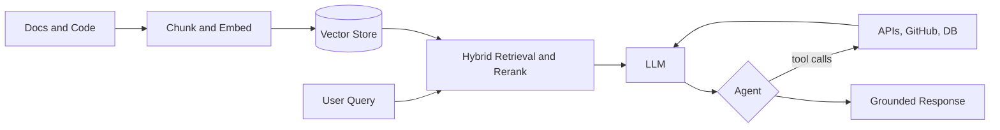

<div align="center">


<br/>

<a href="https://portfoliov1.saswatranjan.site/"></a>
<a href="https://linkedin.com/in/saswat-ranjan-mohanty-568787228"></a>
<a href="mailto:saswatranjan0602@gmail.com"></a>


</div>

<br/>

## About

AI Engineer with about three years of full-stack experience. I build AI-powered products end to end: RAG pipelines, agentic workflows, and LLM integrations, backed by production-grade web and mobile engineering.

```ts
const saswat = {
  role: "AI Engineer",
  focus: ["RAG", "Agentic workflows", "LLM integration"],
  stack: ["TypeScript", "Next.js", "Node.js", "Python", "LangGraph"],
  building: "RepoSage",
  openTo: ["AI engineering roles", "Collaborations"],
} as const;
```

## How I build RAG and agents



## Selected projects

<table>
<tr>
<td width="33%" valign="top">

**RepoSage**
<br/>Agentic codebase assistant. Chat with a repo using RAG over code and docs, with GitHub tool actions and multi-step LangGraph agents.
<br/><br/>
<sub>`TypeScript` `LangGraph` `Qdrant` `BullMQ` `LangSmith`</sub>

</td>
<td width="33%" valign="top">

**Personal Knowledge Assistant**
<br/>Local-first RAG over notes, PDFs, and code. Runs local models with tool calling and session memory.
<br/><br/>
<sub>`Python` `FastAPI` `Ollama` `Qwen3` `ChromaDB`</sub>

</td>
<td width="33%" valign="top">

**SyncKit**
<br/>Offline-sync engine for npm. Works across Expo, browser, and Node with logical clocks and pluggable conflict resolution.
<br/><br/>
<sub>`TypeScript` `Turborepo` `Vitest` `fast-check`</sub>

</td>
</tr>
</table>

## Tech stack

**AI and LLM**
<br/>


**Engineering**
<br/>

<br/>


## GitHub

<table>
<tr>
<td width="50%">

<picture>
  <source media="(prefers-color-scheme: dark)" srcset="https://github-readme-stats.vercel.app/api?username=Saswat0602&show_icons=true&theme=github_dark&hide_border=true&bg_color=0d1117&title_color=2f81f7&icon_color=2f81f7&count_private=true" />
  <source media="(prefers-color-scheme: light)" srcset="https://github-readme-stats.vercel.app/api?username=Saswat0602&show_icons=true&theme=default&hide_border=true&bg_color=ffffff&title_color=0969da&icon_color=0969da&count_private=true" />
  
</picture>

</td>
<td width="50%">

<picture>
  <source media="(prefers-color-scheme: dark)" srcset="https://github-readme-stats.vercel.app/api/top-langs/?username=Saswat0602&layout=compact&theme=github_dark&hide_border=true&bg_color=0d1117&title_color=2f81f7&langs_count=6" />
  <source media="(prefers-color-scheme: light)" srcset="https://github-readme-stats.vercel.app/api/top-langs/?username=Saswat0602&layout=compact&theme=default&hide_border=true&bg_color=ffffff&title_color=0969da&langs_count=6" />
  
</picture>

</td>
</tr>
</table>

<picture>
  <source media="(prefers-color-scheme: dark)" srcset="https://github-readme-activity-graph.vercel.app/graph?username=Saswat0602&bg_color=0d1117&color=8b949e&line=2f81f7&point=ffffff&area=true&area_color=2f81f7&hide_border=true&hide_title=true" />
  <source media="(prefers-color-scheme: light)" srcset="https://github-readme-activity-graph.vercel.app/graph?username=Saswat0602&bg_color=ffffff&color=57606a&line=0969da&point=24292f&area=true&area_color=0969da&hide_border=true&hide_title=true" />
  
</picture>

<picture>
  <source media="(prefers-color-scheme: dark)" srcset="https://raw.githubusercontent.com/Saswat0602/Saswat0602/output/github-snake-dark.svg" />
  <source media="(prefers-color-scheme: light)" srcset="https://raw.githubusercontent.com/Saswat0602/Saswat0602/output/github-snake.svg" />
  
</picture>

<div align="center">


</div>
